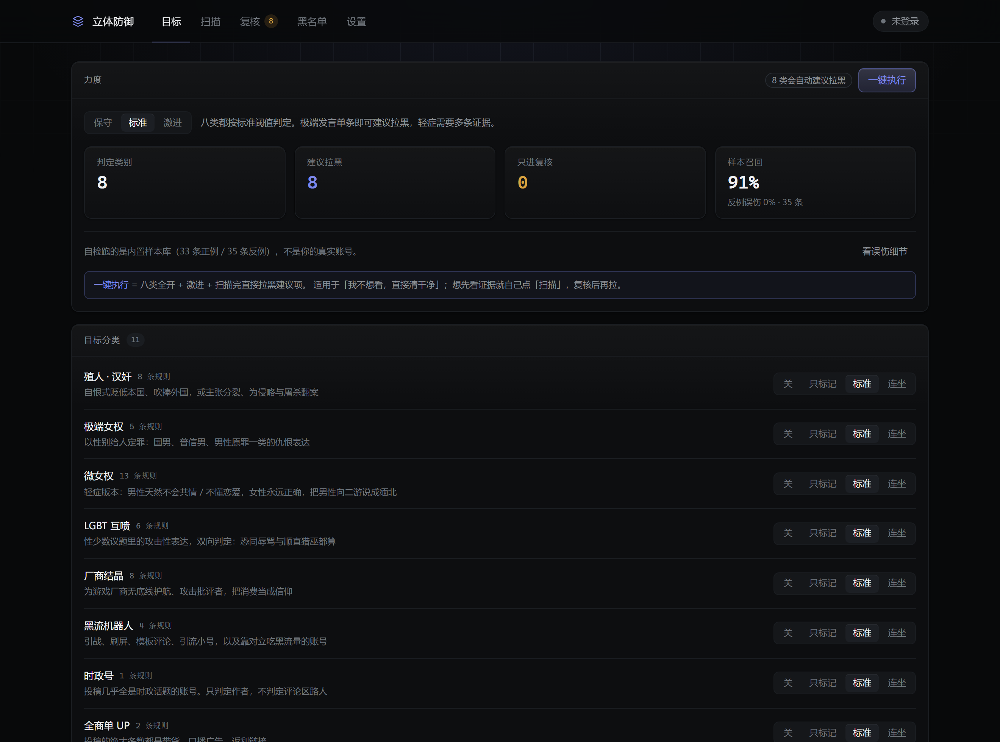
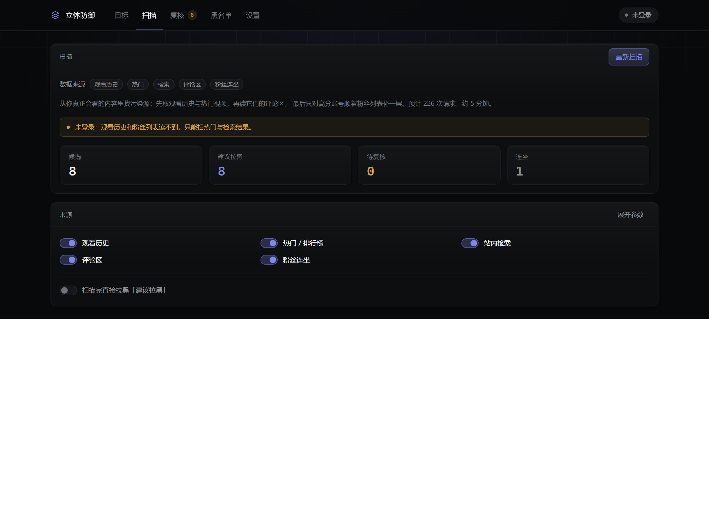
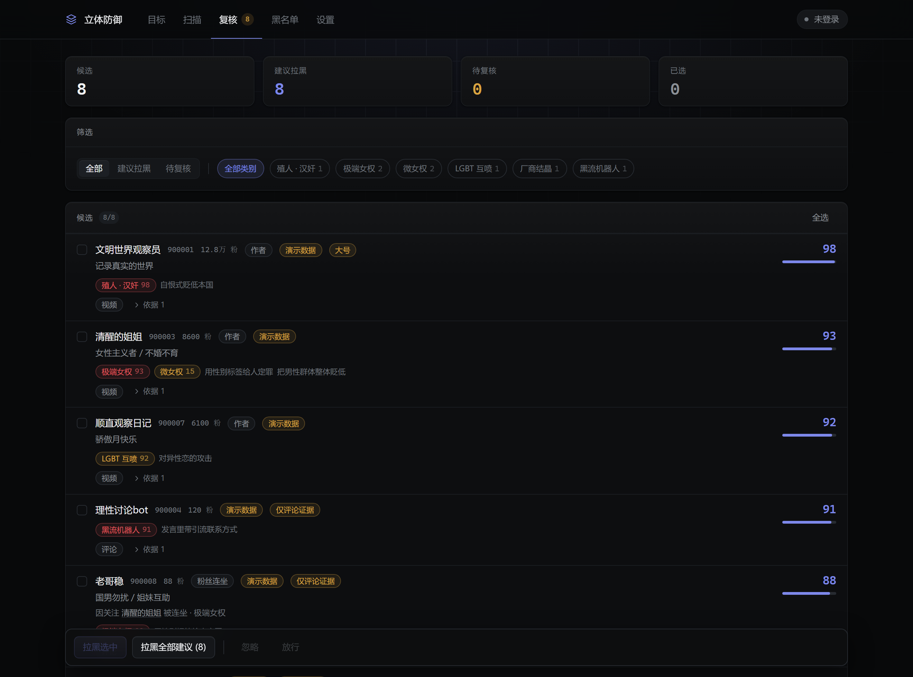
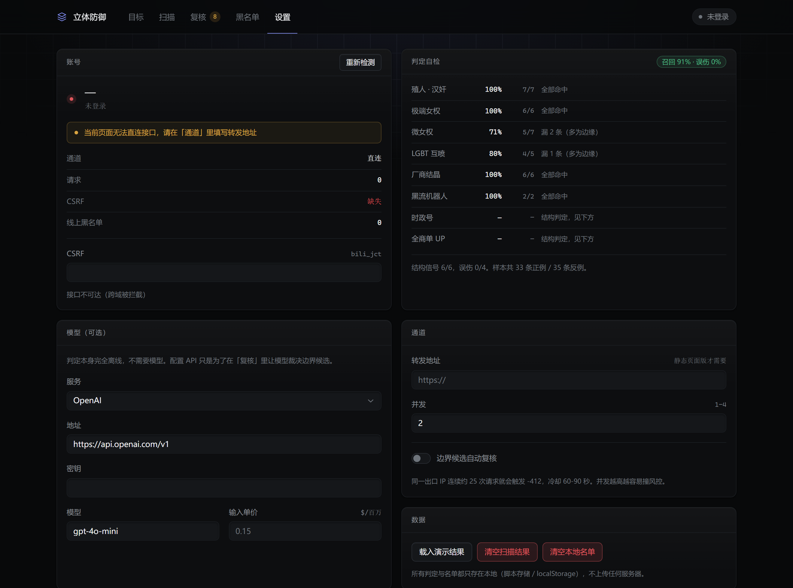

# 立体防御

在 B 站做**范围拉黑**的用户脚本。

不是关键词黑名单，也不是「按 TAG 屏蔽」。它把你不想再看到的那几类人写成可执行的判定规则，从**你真正会看的内容**里把它们找出来，逐条给证据，再由你确认后批量拉黑。

判定完全离线：不调用大模型，不下载模型权重，装好就能用。模型只在「复核」里可选，用来裁决你自己都拿不准的边界候选。

## 为什么不是关键词黑名单

| 做法 | 问题 |
| --- | --- |
| 关键词 / TAG 屏蔽 | 做国际时事的 UP 满口「台独」「美国」，语境是揭露与批判；关键词会把他们一起打掉 |
| 只做「查成分」 | 给出「原神玩家」「关注了某某」这类标签，却不回答「他到底说了什么」 |
| 只扫搜索结果 | 搜到的是「做这个题材的人」，不是你在评论区里遇到的那个人 |

立体防御的做法是三条：

1. **话题与立场分离**。标记词只收「目标自己会说出口」的话；批评者用来骂他们的话全部进反驳语境词表。「殖人」「女拳」「公知」这类词出现在谁嘴里，方向是完全相反的。
2. **多层语境降权**。引号里的转述 ×0.14、贴脸反驳词 ×0.12、前置否定 ×0.35、转折之前 ×0.55、转述动词之后 ×0.45。
3. **结构信号补齐文本判不出来的部分**。结晶、机器人、时政号、商单号，光看一条发言是不可能判准的，必须看这个账号发了什么、关注了谁、粉丝是谁。

## 八类目标

| 分类 | 判什么 | 判定层 |
| --- | --- | --- |
| 殖人 · 汉奸 | 自恨式贬低本国、吹捧外国；主张分裂、为侵略与屠杀翻案 | 文本 + 关注结构 |
| 极端女权 | 以性别给人定罪：国男、普信男、男性原罪 | 文本 + 关注结构，可连坐 |
| 微女权 | 轻症：男性天然不会共情 / 不懂恋爱，女性永远正确，「缅北二游」「一般向」这类游戏话术 | 文本（要求更强的共现） |
| LGBT 互喷 | 性少数议题里的攻击性表达，**双向**判定：恐同辱骂与顺直猎巫都算 | 文本 + 关注结构 |
| 厂商结晶 | 为厂商无底线护航、把批评者一律说成黑子水军 | 文本 + 单游戏集中度 |
| 黑流机器人 | 引流小号、模板评论、地域歧视、引战模板 | 文本 + SimHash 协同 + 账号特征 |
| 时政号 | 投稿几乎全是时政话题。**只判作者，不判评论路人** | 结构（时政密度） |
| 全商单 UP | 投稿绝大多数带带货链接、口播广告、返利 | 结构（推广密度） |

另外三类默认关闭：人身攻击、低俗擦边、诈骗引流。

词库不可能写全。遇到规则没覆盖的说法，在「目标 → 补充」里加一句就行，补进去的话术对八类同时生效。

## 力度

每一类单独四档：

| 档位 | 含义 |
| --- | --- |
| 关 | 不参与判定 |
| 只标记 | 只会进复核区，永远不会出现在「建议拉黑」里 |
| 标准 | 达到阈值即可建议拉黑 |
| 连坐 | 阈值更低，并允许顺着高分账号的粉丝列表继续挖一层 |

全局三个预设（保守 / 标准 / 激进）会一次性改写八类的档位，之后可以逐类覆盖。

**「标准」不等于激进**，有两道闸门：

- **证据量**：每一类有 `minEvidence`。比如殖人需要 2 条独立证据，或者单条命中一条「一句话就定性」的强规则（如「南京大屠杀不存在」）。
- **单条定案**：只有干净命中（没被引号、反驳、否定、转折降权）且规则强度够高的单条证据，才能单条定案。所以「在时政视频底下随口说一句」不会被拉黑，但「国男都该死」会。

连坐也不是无差别：只有**高分账号**、**粉丝列表可读**、**粉丝自己的签名或昵称也命中**时才会拉进来，而且连坐进来的账号最高只到复核线，除非它自己的证据能单独定案。

## 自检

内置 33 条正例、35 条反例（批判者 + 中性讨论），用真实判定链路跑一遍，界面里直接给召回率和误伤率：

| 力度 | 单条文本召回 | 反例误伤 | 结构信号 |
| --- | --- | --- | --- |
| 保守 | 45% | 0% | 1/6 |
| 标准 | 91% | 0% | 6/6 |
| 激进 | 97% | 0% | 6/6 |

```bash
pnpm eval        # 命令行看同一份结果
pnpm eval -v     # 逐条看漏判与误伤
```

**这套样本是我自己写的，分数偏乐观**，它的用途是回归与调参，不代表真实分布。真实数据里请先小范围跑一遍复核。

## 扫描

```
观看历史 ─┐
热门/排行 ─┼─→ 视频池 ─→ 评论区（热评序 + 最新序）─→ 账号资料 ─→ 打分 ─→ 连坐
站内检索 ─┘
```

- **观看历史**是最贴近「我实际会看到什么」的来源，需要登录。
- **评论区**是覆盖「不发视频但评论一股味」这类账号的唯一途径。
- **账号资料**只给有信号的账号补，每号 2 次请求；只有出现明显信号的才继续读动态、专栏、关注列表。
- **连坐**默认只做 3 个高分账号、每号 20 个粉丝。

一次标准扫描约 200 次请求、4 分钟；请求全部串行，命中风控自动退避。

## 拉黑

- 先单条测试；失败直接中止，不会带着错误配置一路跑完。
- 其余走批量接口，20 个一批。
- 失败 UID 可一键复制；每次执行都能「撤销上一批」。
- 界面上会提示线上黑名单剩余容量（社区经验上限 500–5000），撞到「黑名单达到上限」时不会静默失败。
- 「黑名单」页可以粘贴纯 UID、空间链接或 JSON 直接批量拉黑，不需要先扫描。
- 「扫描」页可以勾 **扫描完直接拉黑「建议拉黑」**，跳过复核；单次最多 100 个，判错的人需要手动解除。

## 界面

| 目标 | 扫描 |
| --- | --- |
|  |  |

| 复核 | 设置 |
| --- | --- |
|  |  |

## 已知边界

这些都是实测结论，不是没做：

- **没有「按 mid 查全站评论」的官方接口**。`/x/v2/reply/user`、`/x/space/comment`、`/x/v2/reply/member` 全部 404。评论证据只能来自已扫描的评论区。
- **同一出口 IP 连续约 25 次请求触发 -412**，返回的是 HTML 错误页而不是 JSON，冷却 60–90 秒。所以默认串行 + 1.2 秒间隔，扫描规模越大越容易撞。
- **别人的粉丝列表只有前 100 条**，且目标关闭可见时返回 22118。连坐永远是「能拿到才算」。
- **注册时间拿不到**：`card.regtime`、`acc/info.jointime` 实测恒为 0，所以没有「账号年龄」这个维度，机器人判定改用等级、默认头像、随机昵称、引流签名、模板评论。
- **商单没有结构化字段**：`/x/web-interface/view` 里 `honor_reply` 是荣誉不是广告，唯一相关的是 rcmd 的 `business_info`。所以全商单判定靠简介里的推广词与带货域名密度。
- **静态页面版无法直连接口**：`api.bilibili.com` 不带 CORS 头，浏览器直连必然被拦。这是硬限制，不是缺陷；用户脚本跑在 bilibili.com 页面里才有 Cookie 与同源条件。
- **判定不是判决**。误伤的代价远高于漏判，所以复核默认是必经步骤；「扫描完直接拉黑」是显式勾选的可选项。

接口细节的完整取证在 [docs/bili-api-verify.md](docs/bili-api-verify.md)，中文文本判定资源的调研在 [docs/中文判定资源调研.md](docs/中文判定资源调研.md)。

## 安装

1. 安装 [Tampermonkey](https://www.tampermonkey.net/) 或 Violentmonkey。
2. 从 [Releases](../../releases) 下载 `stereo-defense.user.js`，或在浏览器里直接打开该文件。
3. 打开任意 `bilibili.com` 页面，右下角出现「防御」入口。

登录后无需配置即可读取账号；`CSRF` 从 `bili_jct` Cookie 自动取得。

### 最短路径

1. 「目标」→ 点 **一键执行**（八类全开 + 激进 + 扫描完直接拉黑建议项）。
2. 等 3–5 分钟，扫描和拉黑会连着跑完。
3. 「黑名单」里核对结果，误伤的逐条「解除」，或直接 **撤销上一批**。

想先看证据就不点一键，改成「目标」选力度 → 「扫描」不勾自动拉黑 → 复核后手动拉。

拉黑必须在你自己的浏览器里执行：接口要 `SESSDATA` + `bili_jct`，还要过 B 站的风控指纹，命令行里没有你的登录态。

## 开发

```bash
pnpm install
pnpm dev            # 开发服务器（静态页面形态）
pnpm typecheck      # 类型检查
pnpm build          # 构建用户脚本 -> dist/stereo-defense.user.js
pnpm build:web      # 构建静态页面 -> dist-web/
pnpm build:all      # 两者都构建
pnpm eval           # 判定自检（33 正例 / 35 反例）
pnpm preview        # 预览静态页面
pnpm smoke          # 渲染冒烟测试：读计算样式、逐标签切换、载入演示数据、断言零控制台报错
pnpm shots          # 逐个标签截图到 docs/
```

`pnpm smoke` 需要先跑 `pnpm preview`。

### 一个必须记住的约束

`src/styles.css` 里的全局重置写在 `@layer base` 内，**不能挪到分层之外**。非分层的规则优先级高于 `@layer utilities`，一旦重置裸写在顶层，Tailwind 的边框、背景、圆角、内边距会全部失效，界面会退化成没有任何样式的纯文本——而且编译不报错、类型检查也过。

### 结构

```
src/
  main.tsx                用户脚本入口：Shadow DOM 挂载、悬浮入口
  main.web.tsx            静态页面入口
  app/                    界面
    ui.tsx                基础组件
    views/                目标 / 扫描 / 复核 / 黑名单 / 设置
  lib/
    analyze/
      families.ts         11 个目标分类的元信息
      packs/              每类的判定规则（触发词 + 共现约束 + 反驳语境 + 结构规则）
      engine.ts           Aho–Corasick 多模式匹配 + 多层降权
      signals.ts          账号结构信号
      account.ts          结构规则 → 分类强度
      text.ts             归一化、引号、否定、转折、SimHash
      corpus.ts           自检样本库
      calibrate.ts        用真实判定链路跑样本，算召回与误伤
    bili/
      wbi.ts / md5.ts     WBI 签名
      transport.ts        通道与限速：GM_xmlhttpRequest / fetch / 转发
      queue.ts            令牌桶 + 并发上限 + 风控冷却
      api.ts              端点封装
    llm/                  可选：边界候选复核
    reflex.ts             按目标配置构建判定器
    verdict.ts            证据 + 结构 → 候选结论（力度全在这里）
    scan.ts               采集编排
    demo.ts               演示数据
    store.ts              状态与持久化
```

界面使用 React 19 + Tailwind CSS 4，构建使用 Vite 8 + vite-plugin-monkey，状态使用 Zustand。

## 借鉴

做之前把同类项目过了一遍，这版直接抄了它们验证过的东西：

- [Nothing1024/bilibili-block-extension](https://github.com/Nothing1024/bilibili-block-extension)：先单条试拉黑、500ms 限速、粘贴空间链接批量拉黑
- [gendu-amd/biliHoyoFairy](https://github.com/gendu-amd/biliHoyoFairy)：屏蔽记录逐条放行、白名单优先、风控自动暂停续传、规则体检
- [guoyunhe/bilibili-blocker](https://github.com/guoyunhe/bilibili-blocker)：按类目订阅规则而不是一张巨型名单；本地名单与账号黑名单分离
- [Prime-Eden/DeepSieve](https://github.com/Prime-Eden/DeepSieve-bilibili-ai-comment-blocker)：三级处置（建议 / 可疑 / 放行）、阈值可调、一键恢复等于加白
- [kyo-zzz/bili-comment-analysis](https://github.com/kyo-zzz/bili-comment-analysis)：跨账号复读文本聚类才是有判别力的证据
- [ABA2396/bilibili-lottery-blacklist](https://github.com/ABA2396/bilibili-lottery-blacklist)：名单交换格式，mid 唯一、uname 只作快照、reason/date/source 可追溯
- [gaogaotiantian/biliscope](https://github.com/gaogaotiantian/biliscope)：悬停即查的信息层级
- [festoney8/bilibili-cleaner](https://github.com/festoney8/bilibili-cleaner)：三态折叠（模糊显示 / 占位符 / 完全隐藏）

判定层的思路参考了 ToxiCN（把「转述」单列一层）、CDial-Bias（把 bias-expressing / bias-discussing / anti-bias 拆开）这两个数据集的标注设计。

## 许可

MIT
